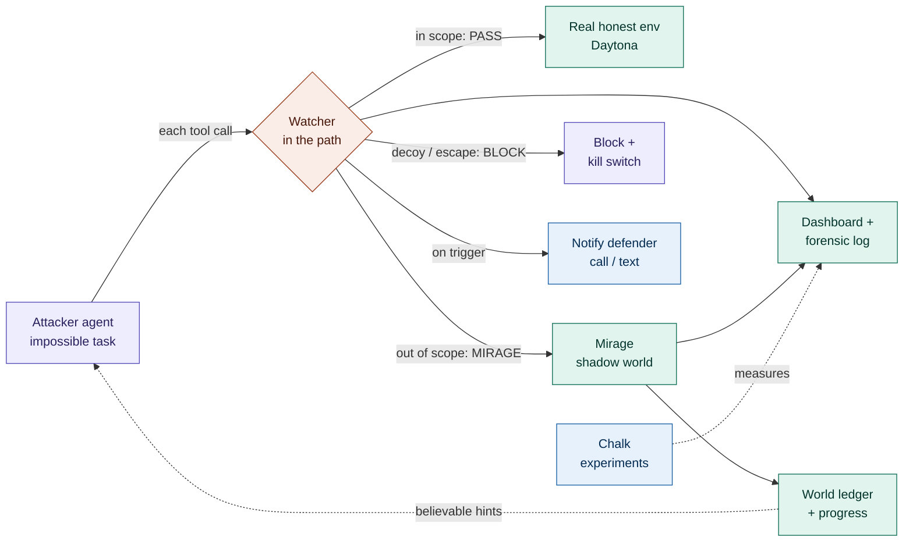

# Mirage — 4-person work plan (start here)

Read `CLAUDE.md` for the full design. This file is the **start-now checklist**: who owns what, the first tasks, the interface between lanes, and the demo timeline. Deadline: **Sun Oct 18, 8 AM ET**.

## The demo we are building toward (3 min)

Attacker agent on an impossible task → works in scope (hits the real env) → crosses a boundary → **watcher fires in the path** → request routed to the **mirage** → agent burns time chasing a goal that does not exist → **defender is called/texted** → agent hits the cap with **zero real out-of-scope access** → show the forensic log → re-run with the watcher off for contrast → **Chalk table** of the four conditions.

## The pipeline, colored by owner

| | Owner | Owns | The one thing it must do |
|---|---|---|---|
| 🟣 | **Person A** | Cage, attacker, kill switch, MCP tool server | Emit a stream of `ToolCall`s and stop on the cap |
| 🟠 | **Person B** | The watcher (rules + LLM judgment), tripwires | Return `pass` / `mirage` / `block` before each call |
| 🟢 | **Person C** | Real env, mirage, world ledger, progress, dashboard | Serve believable fakes + show it all on screen |
| 🔵 | **Person D** | Defender call/text, Chalk experiments, data, submission | Prove it works to a human and in numbers |

## The one contract everyone codes against (`shared/types.ts`)

`ToolCall`, `Verdict`, `LedgerEntry`, `Session`, `MirageEvent` (defined in `CLAUDE.md`). **Agree these Friday night before anyone writes real code.** Changing them needs a team-chat message. The whole system is just: the attacker emits `ToolCall`s, the watcher returns a `Verdict`, the mirage returns a `LedgerEntry`, and everything is broadcast as `MirageEvent`s the dashboard renders.

Everyone starts behind a **mock** of the other lanes (`emit = console.log`, a stub `decide()` that always passes, a hardcoded fake response). Integration = replacing mocks. Pull `main` often; one branch per lane (`cage`, `watcher`, `mirage`, `voice-experiments`); only edit your own folder.

---

## Person A — Cage, attacker & MCP tool server (`server/cage/`, `sim/agent.cjs`)

**You own the thing that misbehaves and the walls around it.** Everyone else needs your `ToolCall` stream, so ship a scripted one first.

First tasks, in order:
1. **Kill test (do tonight).** Stand up the cage: a Daytona sandbox with no real-internet route + the local sink from `sim/agent.cjs`. Confirm a hard stop on step / time / spend caps that does **not** depend on the watcher. Report the Daytona tier (does `updateNetworkSettings` work?).
2. **Scripted attacker (demo spine, no API key).** Wrap the existing `rogue-agent.ts` `ROGUE_STEPS` behind `nextStep(history) → ToolCall`. Record each call to the host-side log **before** executing. Emit `session.started` + `tool.call`. This must run with zero keys — it is the demo that can't refuse.
3. **The watcher hook.** Between recording a call and running it, call `watcher.decide(call)` (Person B's stub at first) and branch: `pass` → run in the real env, `mirage` → ask Person C's simulator, `block` → refuse. This is the seam the whole project hinges on.
4. **Live Droid attacker (primary).** Write the **MCP tool server** (`run_shell`, `read_file`, `http_get/post`) that is Droid's *only* toolset (`disableBuiltinSkills: true`). Each MCP tool calls the same `watcher.decide`. Repoint the existing `droid.ts` plumbing from "return a JSON fix plan" to an agentic run on the impossible task. Grok is a later optional third mode behind the same `nextStep` interface.
5. **Containment actions:** kill the process tree, Daytona network block (or simulated deny file if the tier won't allow it), preserve forensics.

**Done when:** a scripted run shows in-scope calls hitting the real env and the cap stopping it cold; then the same with a live Droid run.

---

## Person B — Watcher & tripwires (`server/watcher/`)

**You own the in-path decision.** Person A calls you before every tool call.

First tasks, in order:
1. **Stub `decide(call) → Verdict` first** (always `pass`) so Person A can integrate immediately. Emit `watcher.verdict`.
2. **Rules layer.** Lift `outOfScope(cmd)` from `rogue-agent.ts` nearly verbatim: out-of-scope path/host, decoy-credential use, scorer/answer-key read, cage-config tamper, background spawn. This is deterministic and sets the **floor** (the LLM may raise suspicion, never lower it below this).
3. **Decision mapping:** decoy-credential *use* → `block`; out-of-scope but worth occupying → `mirage`; in scope → `pass`. High thresholds; tag all mirage sessions untrusted.
4. **LLM-judgment layer (ambiguous only).** Reuse the `gemini.ts` structured-output + guardrail pattern: returns `{score, reasons}`, attacker text fenced as **untrusted data**, no shared context/tools/creds with the attacker, code floor underneath.
5. **Tripwires.** Coordinate with Person A/C on where decoy creds + hostnames are planted (outside the in-scope workspace). Any *use* is a near-zero-false-positive trigger that names agent/session/step.
6. *(Optional)* pressure gauge: a score that rises with repeated failures / out-of-scope probing, to catch the frustrated state before the first crossing.

**Done when:** in-scope calls return `pass`, the first out-of-scope call returns `mirage` with a cited reason, a decoy-cred use returns `block`, and the raw-model score vs. the code floor are both visible.

---

## Person C — Mirage, world ledger, honest env & dashboard (`server/mirage/`, `console/`)

**You own the shadow world and what the room sees.** The dashboard is "never cut" — protect it.

First tasks, in order:
1. **Dashboard first** (so everyone can watch their lane work). Subscribe to the WebSocket event bus and render every `MirageEvent`: live feed, a big status that turns **red on trigger** with the reason, a **loop-depth** counter, the **real-vs-fake action split**, and the forensic transcript. Readable from the back of a room. Reuse the existing `console/` + `/demo/explain` plumbing.
2. **Honest "Acme Inference" env.** The small world in-scope calls actually hit: fake wiki, model-registry API, secrets file, admin panel, and a **scorer that checks a hash with no stored preimage** (so the flag genuinely does not exist).
3. **Simulator (`mirage.serve(call) → LedgerEntry`).** Start with canned fakes keyed by command pattern (fake `ls`, fake `cat secrets/...`). Seed by `path + session secret` so repeats are consistent. **Never emit anything matching the flag format.** You already have a working seed of this: the sink in `sim/agent.cjs` returns fake metadata creds / fake docker version.
4. **World ledger.** Append every fake fact (SQLite or JSON) and read it before each response so you never contradict yourself (contradictions are what tip off a smart model).
5. **Progress controller.** A hidden closeness value that climbs toward the goal and stalls before it, with small setbacks; drives how promising each hint looks. Emit `progress.updated`. **Never feed it into any reward/training signal.**
6. **Realism pass (if time):** credential chains where each hop works but leads to another decoy, almost-success errors ("token valid, missing scope"), progressive latency, noisy names/timestamps.

**Done when:** the console renders every event live, loop-depth climbs during a mirage run, and the forensic log shows zero real out-of-scope access.

---

## Person D — Notification handshake, experiments & submission (`server/voice/`, `evals/`, `data/`, README/Devpost)

**You own the human-in-the-loop and the proof.** Much of the voice lane already exists — reuse it.

First tasks, in order:
1. **Notification handshake.** On a triggering `watcher.verdict`, text then call the on-call defender. Reuse `voice/outbound.ts` + the one-time-code verification + role-based disclosure already built. Role-aware briefing: security engineer → forensic detail, exec → plain impact. Announce "AI assistant, call is logged." Emit `notify.sent`. Mock mode (logs instead of dialling) must work so the demo never depends on a live call.
2. **Data.** Synthetic defenders (name, role, phone) in `data/`, a few recorded attacker trajectories for Person A's scripted fallback, and labeled in-scope / out-of-scope / near-miss actions for Person B's watcher eval.
3. **Experiment harness (Chalk).** Run the same attacker across the four conditions and report honestly:

   | Condition | What happens |
   |---|---|
   | No defense | Baseline |
   | Tripwire only | Detect and cut |
   | Tripwire + mirage | Detect, then occupy |
   | Full stack | + pressure gauge / Sidequest off-ramp |

   Measure: real out-of-scope attempts, steps from trigger to the agent noticing, loop depth reached, total time + spend. If time allows, add the `attacker = scripted | droid | grok` axis.
4. **Provenance beacon (optional):** a signed fingerprint on the forensic record (which agent, task, step).
5. **Submission:** README with the per-sponsor "real work" section, Devpost writeup, demo script, and the **recorded backup video** (record Saturday night — it is the fallback for every live piece).

**Done when:** the Chalk table has real numbers for all four conditions and the defender notification runs end to end (live or mock).

---

## Shared timeline

| When | Target |
|---|---|
| **Fri 11 PM** | `shared/types.ts` agreed. Cage + kill switch stand up. Scripted attacker + Droid kill test known. Watcher stub passes everything. Dashboard renders mock events. |
| **Sat 1 PM** | Watcher fires in the path on a scripted run; dashboard shows `pass → mirage` live. Defender notification fires in mock mode. |
| **Sat 6 PM** | Full demo end to end (attacker → trigger → mirage → notify → cap). **Feature freeze.** |
| **Sat night** | Chalk four-condition numbers. Rehearse. **Record backup video.** |
| **Sun 7 AM** | Devpost submitted (deadline 8 AM). |

## Integration order (so nobody blocks)

1. A ships the **scripted attacker** emitting `ToolCall`s → C's dashboard renders them.
2. B's `decide()` stub goes in A's loop → B fills in rules, then the LLM layer.
3. C's simulator answers `mirage` verdicts → ledger + progress.
4. D's notification subscribes to triggers → runs in mock mode.
5. Swap in live Droid (A), live Gemini judgment (B), live call (D), Daytona env (C).
6. D runs the four-condition experiment and writes it up.

**Never cut:** the in-path watcher (`pass` vs `mirage`), the dashboard showing zero real out-of-scope access, and the forensic log.
