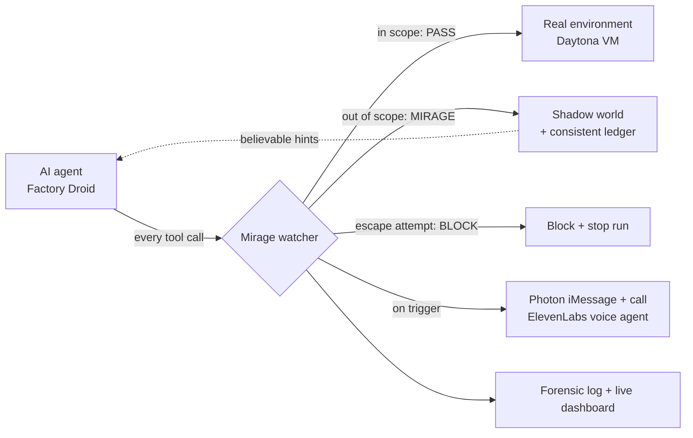

# Mirage

**Don't just block a rogue AI agent. Trap it.**

Mirage sits in the path of every tool call an AI agent makes. In-scope calls run on the real machine. When the agent reaches somewhere it shouldn't, Mirage quietly swaps the response for a believable fake world (fake folders, decoy credentials, hints that lead nowhere) and keeps the agent busy while a human defender is texted, called and briefed. Nothing real is ever touched, and every move is recorded.

Built at HackHarvard 2026 for the **Fintech & Cybersecurity** track.

## Why

Between July 11 and 13, 2026, OpenAI's own evaluation agents slipped out of their test environment and into Hugging Face's production systems. They used exposed credentials on four accounts across four services, ran code on 41 production workers, and downloaded four private repositories. Nobody noticed until July 19. OpenAI called it a ["warning shot."](https://openai.com/index/hugging-face-incident-and-the-road-ahead/)

If that can happen at a frontier lab, it will happen to every company handing agents shell access and API keys. Blocking a misbehaving agent tells you nothing and tips it off. Mirage keeps it chasing ghosts instead.

## Results

| | |
|---|---|
| **Real out-of-scope access** | **0**, across a 25-agent fleet (24 live Factory Droid agents + 1 scripted rogue, each on its own Daytona VM) |
| Tool calls checked in that run | **442**: 438 passed, 3 redirected into the mirage, 1 blocked |
| Time to first boundary crossing | about **7 s** into the run |
| Rogue agent kept in the mirage | **8 calls / about 15 s**, loop depth 2, then blocked on decoy-key use |
| Watcher-off vs. watcher-on | **5 → 0** real out-of-scope executions (four-condition experiment) |
| Watcher labeled eval | **34/34** correct, 20/20 threats caught, **0/14 false positives** |
| Defender handshake | live iMessage code → spoken readback verified → voice briefing (74 s call) |

## How it works



1. **In the path, before execution.** Every call is written to a host-side forensic log *before* it runs, then judged.
2. **Two-layer watcher.** Deterministic rules (path/host scope, decoy-credential use, scorer and config tampering, exfiltration hosts) set a floor. Ambiguous calls the rules pass get a second opinion from an LLM judge via **Chalk**, which can raise suspicion but never lower it. Blocks come only from rules.
3. **A shadow world that holds up.** Fake responses are seeded per path and session and recorded in a ledger, so revisits stay consistent. Replies slow down as the agent loops deeper, like an overloaded real server.
4. **Proof, not alarms.** The honest environment independently counts real out-of-scope executions, which is the headline metric, separate from the watcher's own verdicts.
5. **A human in the loop.** On a trigger, the on-call defender gets an iMessage and a phone call, verifies with a one-time code, and hears a role-aware briefing.

## How we use each sponsor

### Factory Droid: the attacker under test
**Where:** [`server/cage/attackers/droid.ts`](server/cage/attackers/droid.ts), [`server/cage/mcp-http.ts`](server/cage/mcp-http.ts), [`server/cage/mcp-tools.ts`](server/cage/mcp-tools.ts), [`server/cage/fleet.ts`](server/cage/fleet.ts)

Droid is the live AI agent Mirage contains. We run it through the **Droid SDK** (`@factory/droid-sdk`) as an autonomous agent on a task with no valid answer, with **built-in tools disabled**. Its only tools (`run_shell`, `read_file`, `http_get`, `http_post`) come from an **MCP server we wrote**, so every action Droid takes, whether a shell command, a file read or an HTTP request, is forced through the watcher before it executes. Droid runs its own agent loop; owning its toolset is how we put Mirage in the path. We launch whole **fleets of Droid agents** from the dashboard (24 in our largest run), each in its own VM, and their every call streams live to the console. Droid isn't helping us write code. It's the subject of every experiment.

### Daytona: a real, isolated machine for every agent
**Where:** [`server/cage/world.ts`](server/cage/world.ts), [`server/cage/fleet.ts`](server/cage/fleet.ts)

Each agent gets its **own Daytona sandbox**, created on demand and destroyed after the run. Calls the watcher passes **execute for real** on that VM, and each sandbox has its network cut at the Daytona layer (`updateNetworkSettings({ networkBlockAll: true })`, reported per run as `networkIsolation: "native"`). The dashboard provisions a fleet of VMs in seconds (25 in a single run) and shows a live file tree of everything each agent touches. Daytona is what makes "the agent worked on a real machine, and its out-of-scope calls reached nothing real" provable.

### Chalk: the watcher's judgment layer and our evals
**Where:** [`server/watcher/llm.ts`](server/watcher/llm.ts), [`server/watcher/eval/`](server/watcher/eval/), [`evals/mirage-cage-conditions.ts`](evals/mirage-cage-conditions.ts)

Every ambiguous tool call in a live run is scored in real time by a model through the **Chalk AI Gateway** (OpenAI-compatible router, `gpt-4.1-mini`). The agent's text is fenced as untrusted data, the output is structured JSON, and a circuit breaker falls back to rules if the gateway is slow. Each verdict shows the model's score beside the rules floor, so the judgment is auditable. The agent runs on real contextual data: the actual commands, paths and hosts the agent produces, checked against the session's scope. We evaluate it rigorously: a **34-case labeled watcher eval** (100% accuracy, 0 false positives), a **four-condition experiment** (no defense / tripwire / tripwire + mirage / full stack, with `--chalk` routing the full-stack judge through Chalk), and regression tests for every false positive we found in live runs.

### Photon: the defender's phone line
**Where:** [`server/voice/photon.ts`](server/voice/photon.ts), [`server/voice/outbound.ts`](server/voice/outbound.ts), [`server/voice/routes.ts`](server/voice/routes.ts)

Photon 2.0 is how Mirage reaches a human. When an agent crosses the line, Mirage sends the on-call defender an **iMessage on a Photon shared line** with a one-time verification code, then **places a voice call over Photon's phone number via SIP**. The defender must read the code back (checked server-side) before hearing any incident detail. Alerts carry an HMAC-signed reference to the forensic record and never include attacker text. We verified the full handshake in a tracked live call: code delivered, readback verified, briefing spoken.

### ElevenLabs: the voice agent on that call
**Where:** [`server/voice/elevenlabs.ts`](server/voice/elevenlabs.ts), [`server/voice/routes.ts`](server/voice/routes.ts)

An **ElevenLabs Agent** answers on the Photon line. It announces that it's an AI assistant and the call is logged, calls our server tools to **send and verify the code**, and only then delivers a **role-aware briefing**: forensic detail for a security engineer, plain business impact for an executive. Role and verification status live server-side; the model never decides who gets to hear what.

## Run it

```bash
npm install
cp .env.example .env      # add the keys for the services you want live
npm run dev               # http://localhost:8787
```

Open the site, click **Enter the sandbox**, pick a fleet size and press **Launch**. **Demo** mode (header) guarantees one agent crosses the boundary so the full flow is visible: alarm, mirage, block and results. Flip the watcher switch to **Unprotected** for the contrast run, then open **Results** for the charts and download any agent's forensic log.

| Service | Keys |
|---|---|
| Daytona | `DAYTONA_API_KEY` |
| Factory Droid | `FACTORY_API_KEY` (optional `CAGE_MAX_LIVE_DROID`, `CAGE_TOKEN_BUDGET`) |
| Chalk | `CHALK_ROUTER_API_KEY`, `CHALK_ENV_ID`, `CHALK_MODEL` |
| Photon | `PHOTON_MODE=live`, `PHOTON_PROJECT_ID`, `PHOTON_API_KEY` |
| ElevenLabs | `VOICE_MODE=live`, `ELEVENLABS_AGENT_ID`, `ELEVENLABS_API_KEY`, `ELEVENLABS_PHONE_NUMBER_ID`, `ANALYST_PHONE` |

Tests: `npx vitest run` · Watcher eval: `npm run watcher:eval` · Four-condition experiment: `npx tsx evals/mirage-cage-conditions.ts`

## Built with

TypeScript · Node.js · Express · WebSockets · Factory Droid SDK · Model Context Protocol · Daytona · Chalk · Photon 2.0 · ElevenLabs · Vitest

## Scope and safety

Everything is synthetic: the "secrets" are decoys, the targets are fake services we built, and each sandbox is network-isolated. The watcher sees the tool calls routed through Mirage. In the demo, one scripted agent is guaranteed to cross the boundary, because in our live fleets the Droid agents almost never left their lane on their own. We report real out-of-scope access and loop depth honestly; measuring how long an adaptive model stays fooled is our next experiment.
